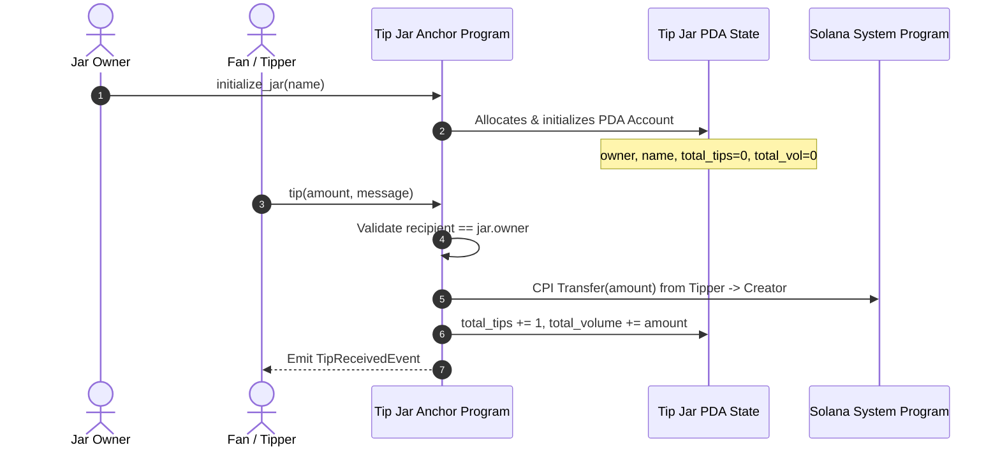

# Module 8: Decentralized Tip Jar MVP (PK1 Build Sprint)

An on-chain decentralized tipping protocol built on Solana using the Anchor framework. It enables creators, builders, and developers to deploy personalized, program-derived Tip Jars to receive non-custodial SOL tips with on-chain metric tracking and event emission.

---

## 🌟 Features
1. **Deterministic PDA Tip Jars**: Jars are derived using seeds `[b"tip_jar", owner.key().as_ref(), name.as_bytes()]`.
2. **Direct Non-Custodial Transfer**: Tips are routed straight to the creator via Cross-Program Invocation (CPI) to the Solana `system_program`.
3. **Real-time On-Chain Analytics**: Tracks total tip count and cumulative volume in lamports directly inside the PDA state account.
4. **Anchor Event Emission**: Emits `TipReceivedEvent` on every tip for frontend websocket notifications and indexing.
5. **Security Constraints**: Strict constraint checking ensures the recipient account strictly matches the registered jar owner.

---

## 🏗️ Architecture & Account Model



---

## 🔒 Security Assumptions & Invariants
- **Recipient Integrity**: `constraint = recipient.key() == jar.owner @ TipJarError::InvalidRecipient` prevents front-running or malicious redirection.
- **Arithmetic Safety**: All mathematical operations use checked addition (`checked_add`) to eliminate overflow vulnerabilities.
- **Input Bounds**: Enforces limits on jar names (max 32 bytes) and tip messages (max 128 bytes) to prevent unbounded rent costs.
- **Signer Authorization**: CPI transfers require explicit signature from the tipper account.

---

## 🚀 Verification & Testing Instructions

1. Install dependencies:
```bash
npm install
```

2. Build and run tests against the local or devnet validator:
```bash
anchor test
```
