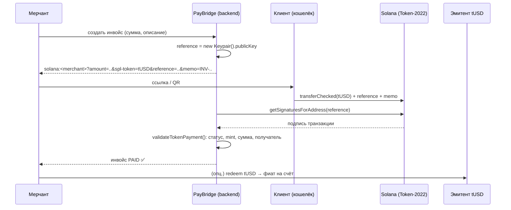

# 🌍 PayBridge — дизайн продукта: кросс-граничные инвойсы в стейблкоинах на Solana

> Неделя 13 · RWA, Stablecoins и платежи. Прототип ключевых механик: [`scripts/stablecoin.ts`](scripts/stablecoin.ts), [`src/solana_pay.ts`](src/solana_pay.ts).
> ⚠️ Учебный проект. Регуляторные утверждения ниже — ориентиры для обсуждения, а не юридическая консультация.

## 1. Проблема

Фрилансер или небольшая студия из Центральной Азии получает оплату от зарубежного клиента:

| Сегодня (банковский SWIFT / P2P-сервисы) | Боль |
|---|---|
| 2–5 рабочих дней до зачисления | кассовые разрывы |
| 3–7 % суммарных комиссий + невыгодный FX-курс | теряется заметная часть маленьких чеков |
| Банки-корреспонденты блокируют или запрашивают документы | непредсказуемость, ручная переписка |
| Нет единого статуса «инвойс оплачен» | ручная сверка платежей |

## 2. Решение

**PayBridge** — инвойс превращается в ссылку или QR **Solana Pay**. Клиент оплачивает его из любого кошелька регулируемым стейблкоином. Фрилансер видит статус «PAID» через секунды. Комиссия сети — доли цента, автоматическая сверка идёт по `reference`-ключу.

**Ценностное предложение:** «Отправил ссылку — получил доллары за 1 секунду и < $0.01 комиссии, с KYC и прозрачным аудитом».

## 3. Пользователи и сценарии

| Роль | Что делает | Требования |
|---|---|---|
| **Мерчант** (фрилансер / SME) | создаёт инвойс, получает tUSD, выводит в фиат | KYC, простой UI, выгрузка для бухгалтерии |
| **Плательщик** (клиент) | открывает ссылку / QR, платит из кошелька | KYC-лайт, никакого лишнего ПО |
| **Эмитент** (регулируемый партнёр) | выпускает и гасит tUSD 1:1 к резервам, KYC, санкционный контроль | freeze / clawback, отчётность |
| **Аудитор / регулятор** | проверяет резервы и движение средств | публичный on-chain след, аттестации |

### Основной поток



## 4. Дизайн токена (Token-2022)

| Требование бизнеса / комплаенса | Расширение Token-2022 | Где в прототипе |
|---|---|---|
| Название, тикер, эмитент, юрисдикция, аттестация резервов прямо в mint | `MetadataPointer` + `TokenMetadata` | шаг [1] |
| Нельзя получать токены без KYC | `DefaultAccountState = Frozen`; KYC = `thawAccount` | шаги [2], [6] |
| Исполнение судебных решений / санкций | `PermanentDelegate` (burn/transfer без подписи владельца) | шаг [6] |
| Мгновенная заморозка скомпрометированного кошелька | `freeze_authority` mint'а | шаг [2] |
| Точная арифметика | 6 decimals, суммы как decimal-строки → `bigint` | `toBaseUnits()` |

**Рассмотренные и отложенные варианты:**
- `TransferHook`: on-chain allowlist / travel-rule проверка на каждом переводе. Нужен для v2, но усложняет интеграцию кошельков.
- `ConfidentialTransfer`: приватность сумм. Конфликтует с прозрачностью для аудитора на MVP-этапе.
- `TransferFee` (неделя 7): возможная модель монетизации, но лучше брать комиссию явно, в момент инвойса.

## 5. Архитектура

```text
┌──────────────┐   ссылка/QR   ┌──────────────┐  transferChecked + reference  ┌───────────────────────┐
│  Web-кабинет │──────────────▶│ Кошелёк      │──────────────────────────────▶│ Solana: Token-2022    │
│  мерчанта    │               │ клиента      │                               │ tUSD mint (extensions)│
└──────┬───────┘               └──────────────┘                               └──────────┬────────────┘
       │ REST                                                                            │ RPC / WebSocket
┌──────▼──────────────────────────────────────────┐                                     │
│ Backend PayBridge                               │◀────────────────────────────────────┘
│  • invoices (id, amount, reference, status)     │  getSignaturesForAddress(reference)
│  • watcher: поиск и валидация платежей          │  getParsedTransaction → validateTokenPayment
│  • KYC-провайдер → запрос thaw у эмитента       │
└─────────────────────────────────────────────────┘
       │ API эмитента (mint/redeem, thaw/freeze)
┌──────▼──────────┐
│ Эмитент tUSD    │  резервы 1:1 в банке-кастодиане, ежемесячная аттестация
└─────────────────┘
```

**Почему on-chain, а не просто БД:**
- расчёт (settlement) и доказательство оплаты публичны и неизменяемы;
- нет банка-корреспондента;
- любой кошелёк может заплатить — не нужно аккаунта в нашей системе.

**Почему Solana:**
- финальность около 1 с, комиссия меньше $0.01 — это критично для чеков $50–500;
- Token-2022 даёт нативные комплаенс-расширения без своего токен-контракта (меньше поверхность атаки, см. неделю 12);
- стандарт Solana Pay поддерживают основные кошельки.

## 6. Комплаенс и регулирование

- **KYC/AML**: аккаунт мерчанта и плательщика размораживается только после KYC. Сделки мониторятся (velocity, суммы, связи с санкционными адресами).
- **Санкции и судебные решения**: freeze плюс clawback через `PermanentDelegate`. Каждое применение публично видно on-chain и логируется во внутреннем реестре с основанием.
- **Travel rule**: для переводов выше порога данные отправителя и получателя передаются между VASP off-chain. В v2 возможна проверка через `TransferHook`.
- **Регуляторный контекст** (актуализировать с юристом под конкретную юрисдикцию):
  - стейблкоины всё чаще регулируются как отдельный класс (например, режим MiCA в ЕС);
  - финансовые хабы предлагают регуляторные песочницы для пилотов;
  - эмитентом должен быть лицензированный партнёр. PayBridge — технологический и платёжный слой, не эмитент.
- **Риск для пользователя от `PermanentDelegate`** раскрывается в оферте: это осознанный компромисс «регулируемый доллар против полной self-custody».

## 7. Бизнес-модель и метрики

| | |
|---|---|
| Доход | 0.5–1 % с оплаченного инвойса (против 3–7 % у банков), платные тарифы для SME (мультивалюта, бухгалтерская интеграция) |
| North-star метрика | объём оплаченных инвойсов в месяц (GMV) |
| Продуктовые метрики | время от отправки ссылки до PAID, конверсия ссылка → оплата, доля повторных клиентов |
| Риск-метрики | доля заблокированных платежей, false-positive KYC, число применений clawback |

## 8. Риски и меры

| Риск | Мера |
|---|---|
| Депег / проблемы эмитента | только регулируемые эмитенты с аттестацией резервов; в v2 поддержка нескольких стейблкоинов |
| Регуляторный запрет в юрисдикции клиента | геоблокировка, юридическое заключение по каждому рынку |
| Компрометация ключей эмитента (freeze / delegate / mint) | multisig (Squads) + HSM, раздельные ключи для mint / freeze / delegate, лимиты |
| Ошибка сверки (двойной зачёт, недоплата) | уникальный `reference` на инвойс, точная `bigint`-арифметика, проверка mint и получателя (`validateTokenPayment` + тесты) |
| UX кошельков для новичков | встроенный кошелёк через email-логин (MPC) на v2 |

## 9. Что реализовано в прототипе и дальнейшие шаги

| Механика | Статус | Доказательство |
|---|---|---|
| Выпуск tUSD с 4 расширениями и on-chain метаданными | ✅ | `results.json → mint_tx_signature` |
| KYC через frozen-by-default + thaw | ✅ | лог шага [2] |
| Инвойс как Solana Pay URL с `reference` | ✅ | `results.json → invoice_url` |
| Поиск платежа по `reference` и валидация | ✅ | `results.json → payment_validated: true`, тесты |
| Блокировка перевода на не-KYC кошелёк | ✅ | `results.json → kyc_block_error` |
| Clawback через `PermanentDelegate` | ✅ | `results.json → clawback_tx_signature` |
| Web-кабинет мерчанта | ➡️ неделя 14 (Capstone Creator Pay, tUSD-чаевые) | |
| TransferHook allowlist, multisig эмитента, off-ramp | 🗓 roadmap | |
